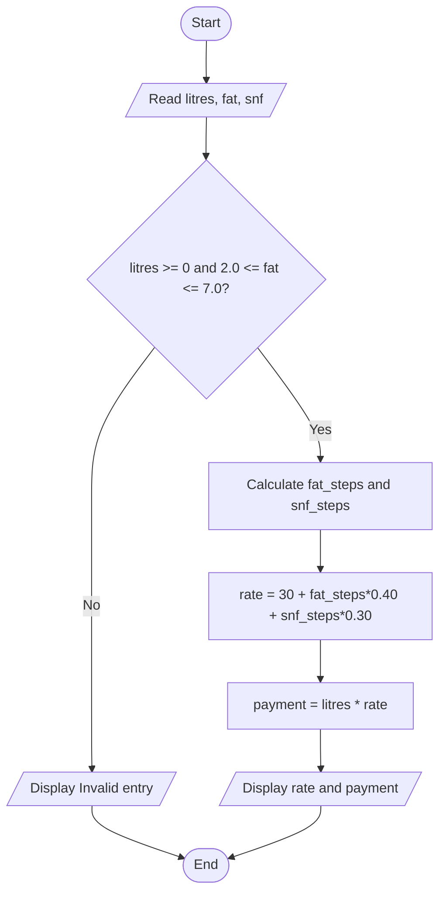

# Task 8 - Plan the Algorithm

Stages: 1 Understand the problem, 2 Plan (pseudocode, flowchart), 3 Write the code, 4 Test it.

## Pseudocode - one payment
    BEGIN
      READ litres, fat, snf
      IF litres < 0 OR fat < 2.0 OR fat > 7.0 THEN DISPLAY "Invalid entry"; STOP
      SET fat_steps TO ROUND((fat - 3.5) / 0.1)
      SET snf_steps TO ROUND((snf - 8.5) / 0.1)
      SET rate TO 30.00 + fat_steps * 0.40 + snf_steps * 0.30
      SET payment TO litres * rate
      DISPLAY rate, payment
    END

## Pseudocode - ten-day total for one farmer
    BEGIN
      SET total TO 0
      FOR day FROM 1 TO 10
        FOR EACH entry of the day
          READ litres, fat, snf
          IF entry is valid THEN SET total TO total + payment of entry
          ELSE DISPLAY "Invalid entry skipped"
      DISPLAY total
    END

## Flowchart (one entry)

## Hand-trace
| Entry | litres | fat | snf | fat_steps | snf_steps | rate | payment | running total |
|---|---|---|---|---|---|---|---|---|
| 1 | 10 | 3.5 | 8.5 | 0 | 0 | 30.00 | 300.00 | 300.00 |
| 2 | 8.5 | 4.2 | 8.7 | 7 | 2 | 33.40 | 283.90 | 583.90 |
| 3 | 12 | 3.1 | 8.3 | -4 | -2 | 27.80 | 333.60 | 917.50 |

(Task06/functions.py prints the same ten-day total, 917.5.)

## List vs running total
| Approach | Time | Space |
|---|---|---|
| Store all entries, total at the end | O(n) | O(n) |
| Running total | O(n) | O(1) |

Keep individual entries only when they are needed later (printing a statement, correcting or
auditing a payment); otherwise a running total is enough.
